# RailConnect 🚆

A mini railway ticket booking backend built using FastAPI, Python and SQLite.

## 📌 Project Overview

RailConnect is a backend system for a fictional railway booking platform.

It provides APIs for:

- Passenger registration and login
- JWT authentication
- Password hashing using bcrypt
- Password reset
- Passenger profile
- Admin station management
- Admin train management
- Train search
- Seat availability
- Ticket booking
- Unique PNR generation
- Booking history
- Ticket cancellation
- Seat restoration after cancellation
- Protected APIs
- API testing using pytest

## 🛠️ Technology Stack

- Python
- FastAPI
- SQLModel
- SQLite
- Pydantic
- Pydantic Settings
- JWT
- python-jose
- bcrypt
- Uvicorn
- pytest
- HTTPX
- Swagger UI

## 📁 Project Structure

```text
railconnect/
├── app/
│   ├── auth/
│   │   ├── router.py
│   │   ├── security.py
│   │   └── dependencies.py
│   ├── admin/
│   │   └── router.py
│   ├── trains/
│   │   └── router.py
│   ├── bookings/
│   │   └── router.py
│   ├── database.py
│   ├── models.py
│   ├── schemas.py
│   ├── config.py
│   └── main.py
├── tests/
│   └── test_api.py
├── screenshots/
├── .env.example
├── .gitignore
├── requirements.txt
└── README.md

```

## 🚀 Setup and Run

Use Python 3.11 or newer. From the project directory:

```bash
python3 -m venv venv
source venv/bin/activate
pip install -r requirements.txt
cp .env.example .env
```

Set `SECRET_KEY` in `.env` to a private random value. You can generate one with:

```bash
python -c "import secrets; print(secrets.token_urlsafe(32))"
```

Keep `.env` private; Git ignores it. Start the API with:

```bash
uvicorn app.main:app --reload
```

Open Swagger UI at `http://127.0.0.1:8000/docs`. Run the tests with:

```bash
pytest -q
```

## 🔌 Main API Endpoints

| Purpose | Endpoint |
|---|---|
| Register and log in | `POST /auth/register`, `POST /auth/login` |
| View profile and log out | `GET /auth/me`, `POST /auth/logout` |
| Request and apply password reset | `POST /auth/forgot-password`, `POST /auth/reset-password` |
| Manage stations | `POST /admin/stations`, `GET /admin/stations` |
| Manage trains | `POST /admin/trains`, `PUT /admin/trains/{train_id}`, `PATCH /admin/trains/{train_id}/deactivate` |
| Search trains | `GET /trains/search` |
| Book, view, and cancel tickets | `POST /bookings/`, `GET /bookings/`, `GET /bookings/{pnr}`, `DELETE /bookings/{pnr}` |

Admin endpoints require an authenticated user with the `admin` role. Password reset is a development flow: the API returns a short-lived, single-use reset token instead of sending email. Logout is client-side; discard the bearer token on the client. Existing access tokens remain usable until they expire.

## 📸 API Screenshots

The following screenshots show the main RailConnect API workflows in Swagger UI:

### Authentication

| Registration | Login | Unauthorized request (401) |
|---|---|---|
| 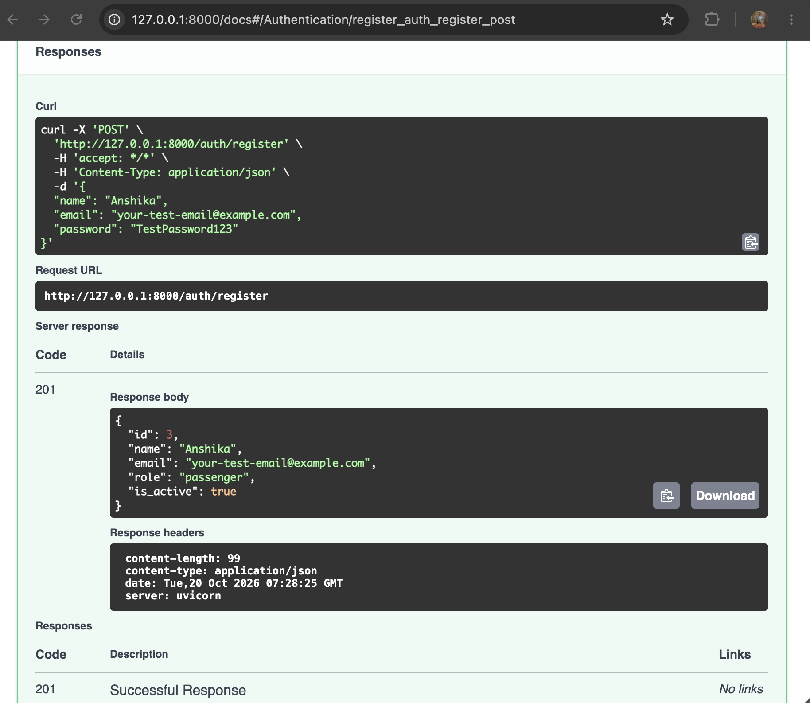 | 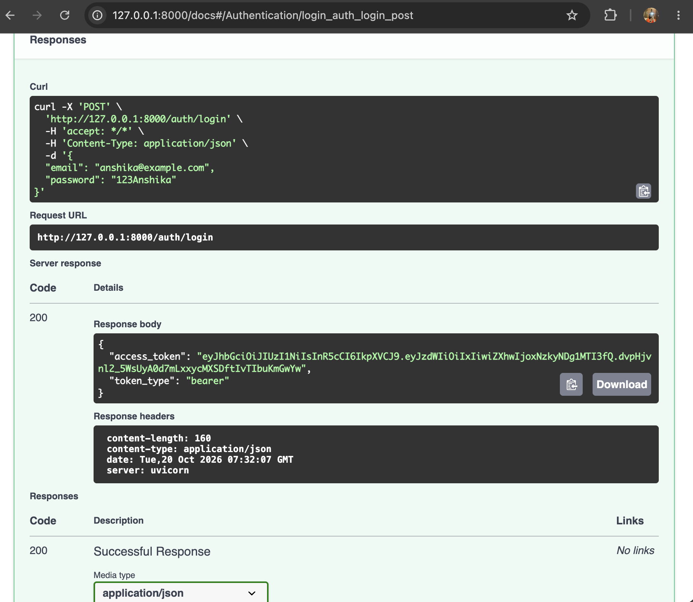 | 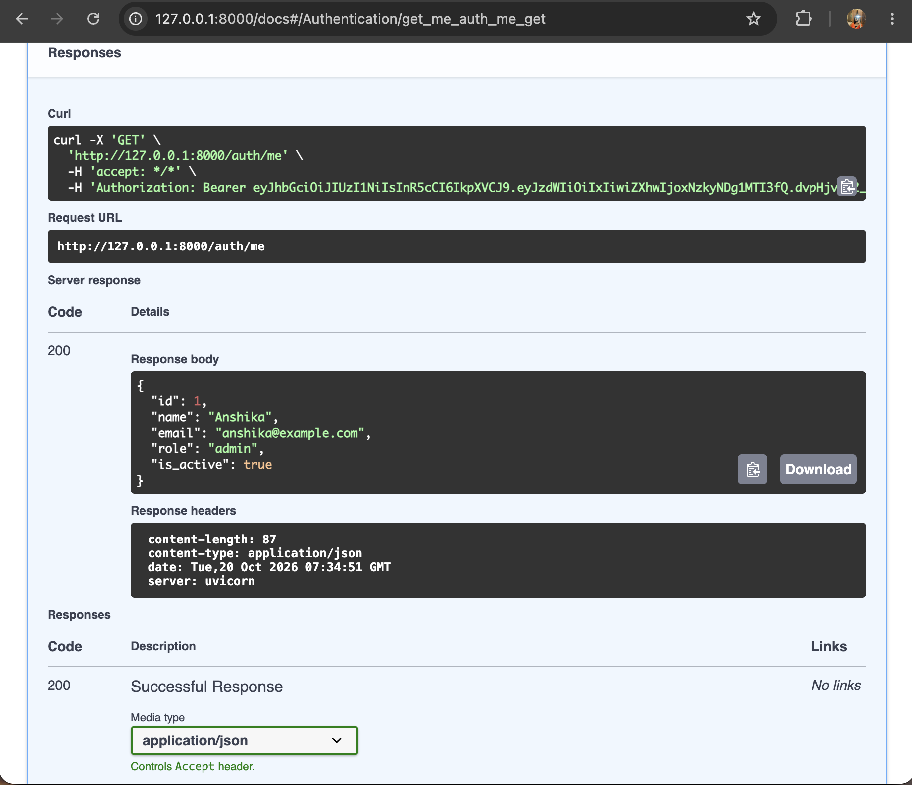 |

### Admin and train search

| Create station | Create train | Search trains |
|---|---|---|
| 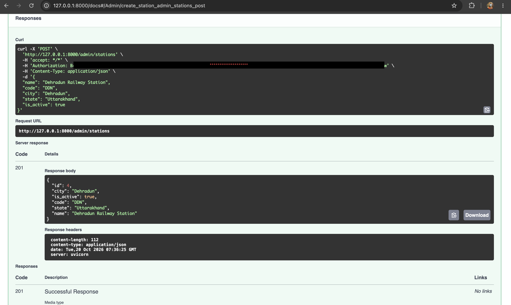 | 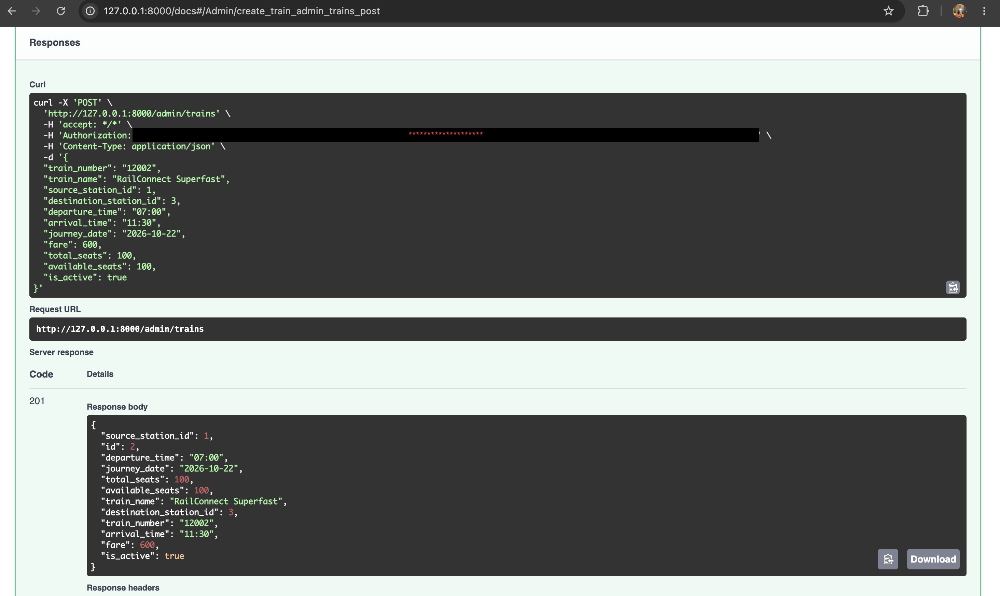 | 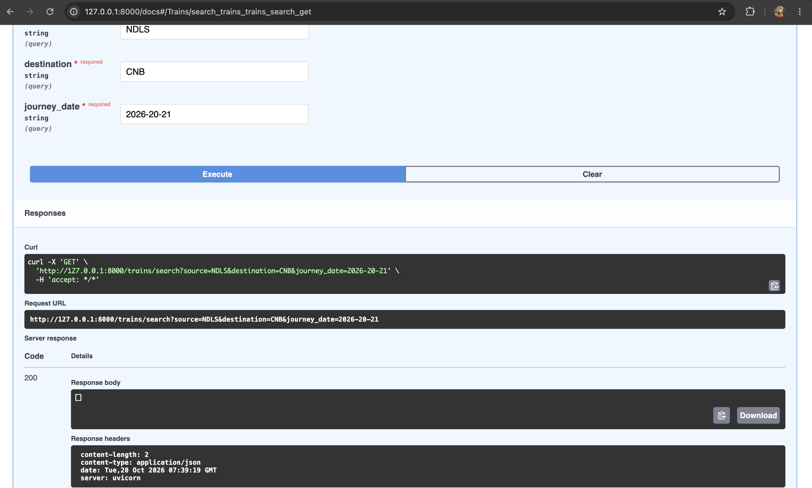 |

### Booking and cancellation

| Submit booking | Booking confirmation with PNR | Cancel booking |
|---|---|---|
| 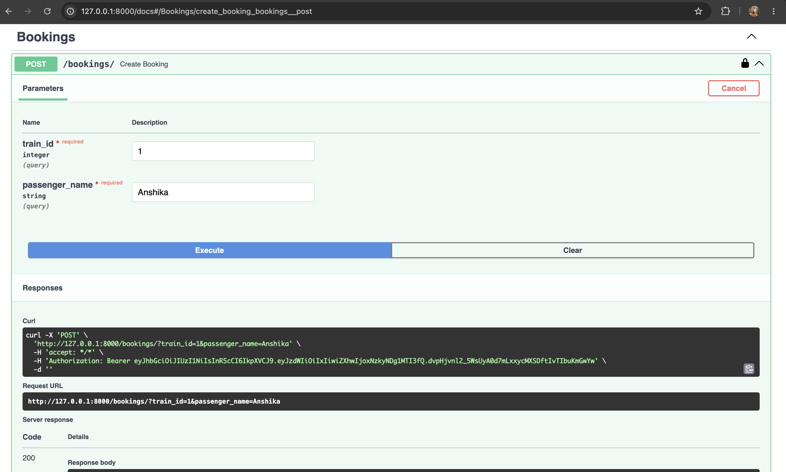 | 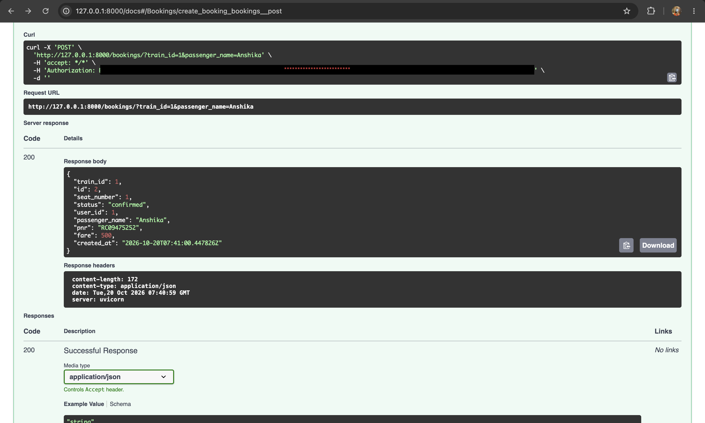 | 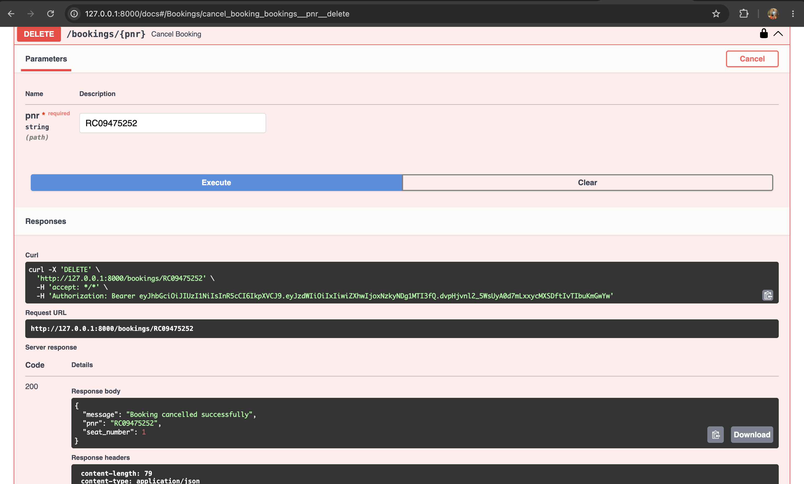 |

### Tests

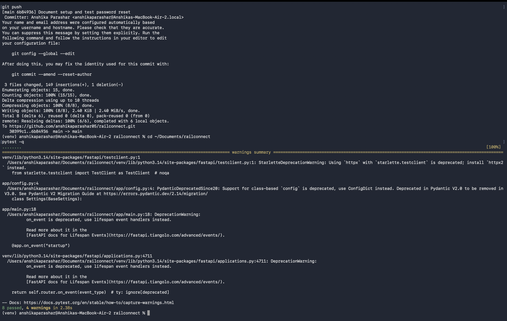
### Password reset

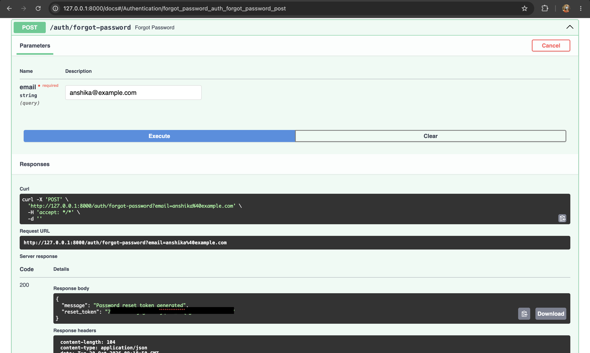

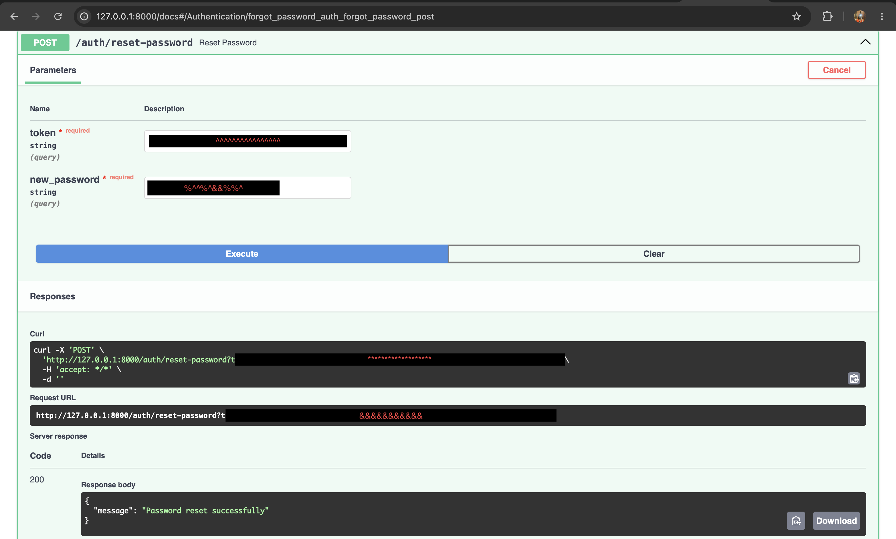

### Booking history

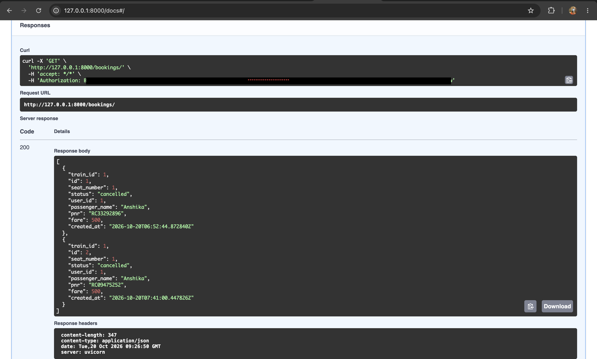